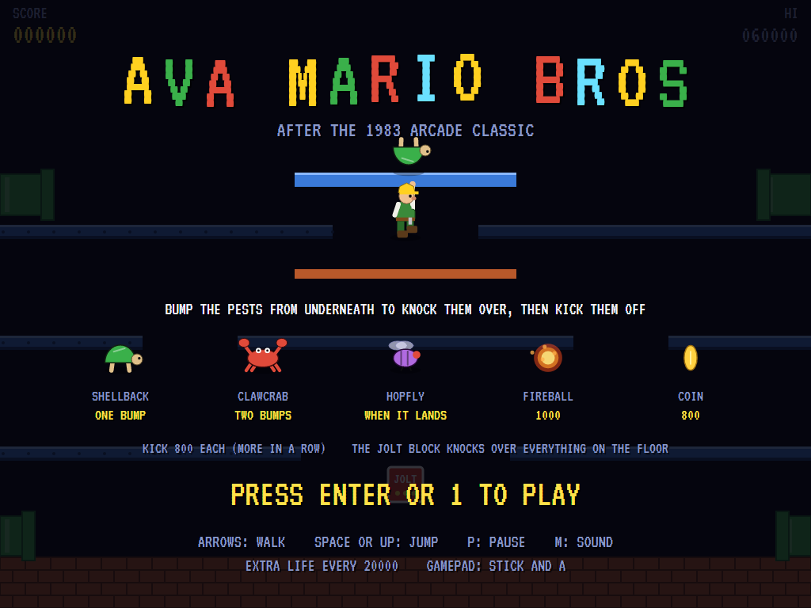
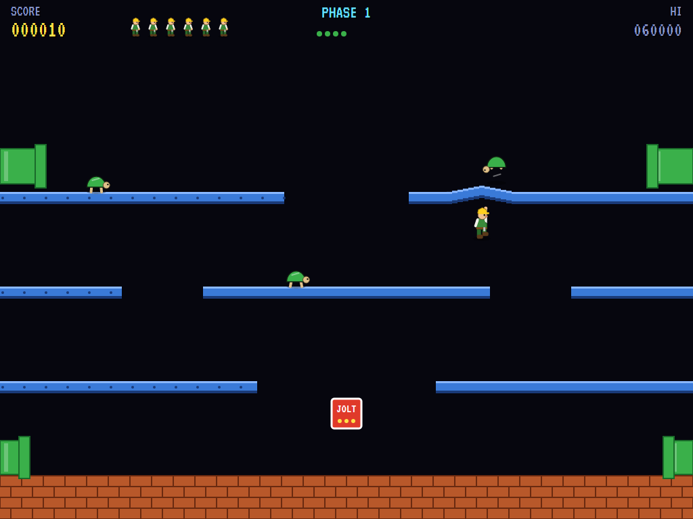
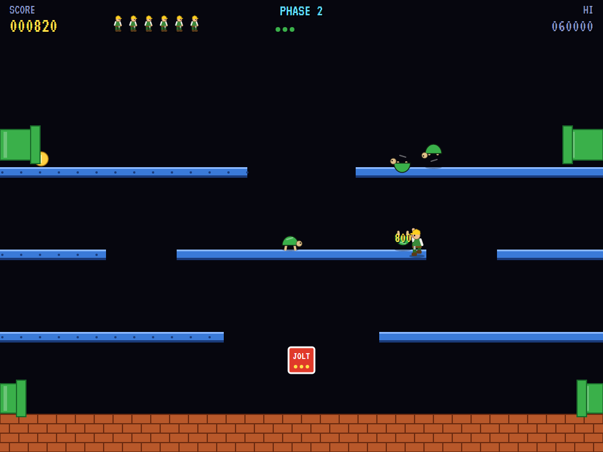
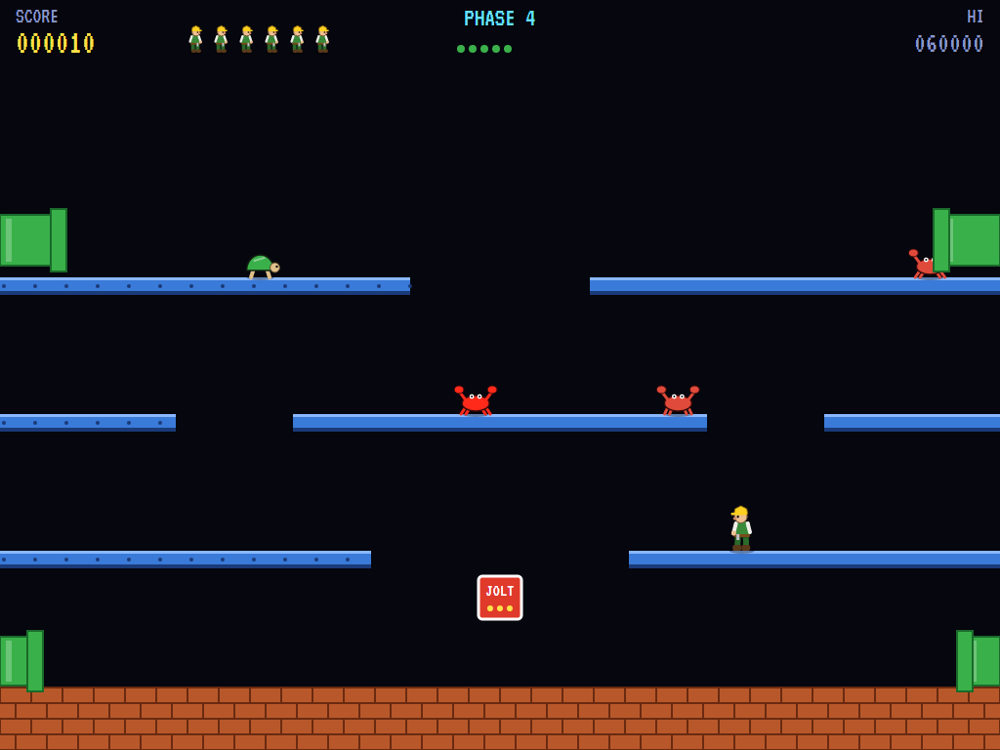
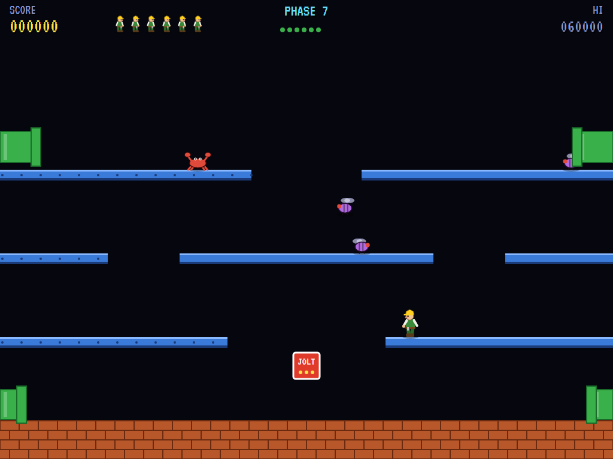
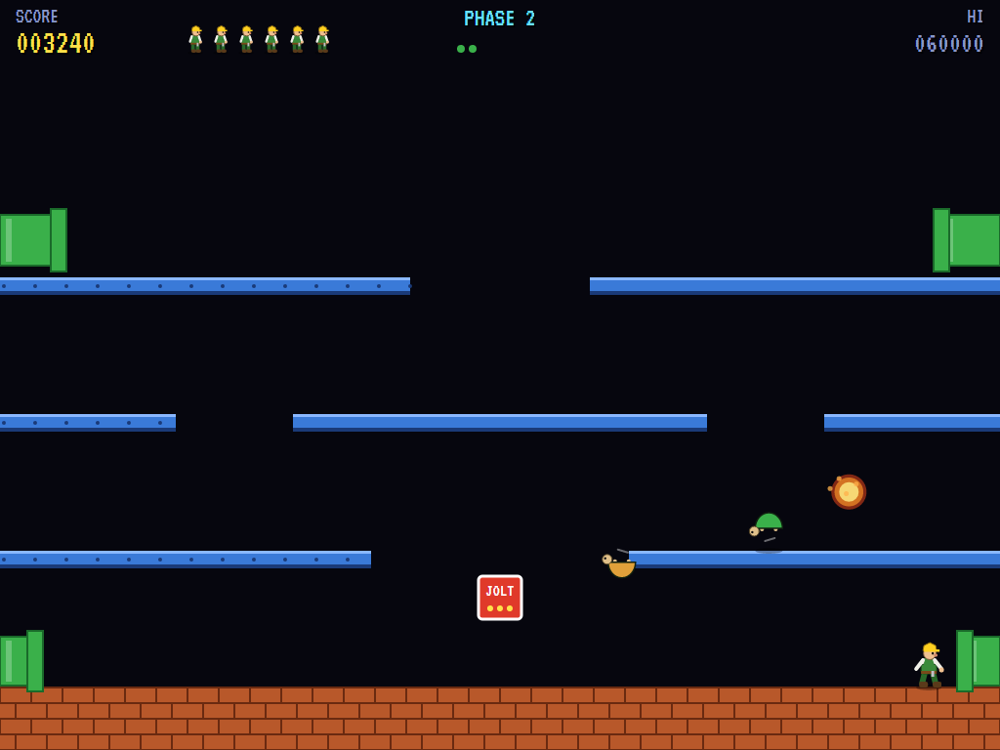
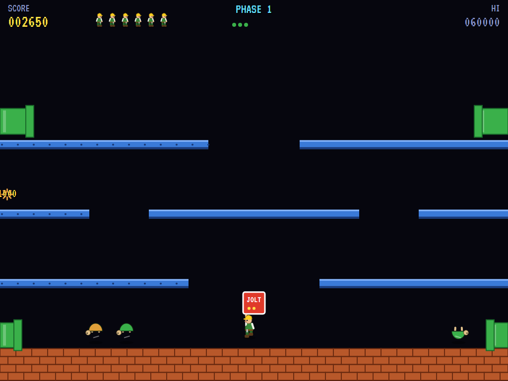
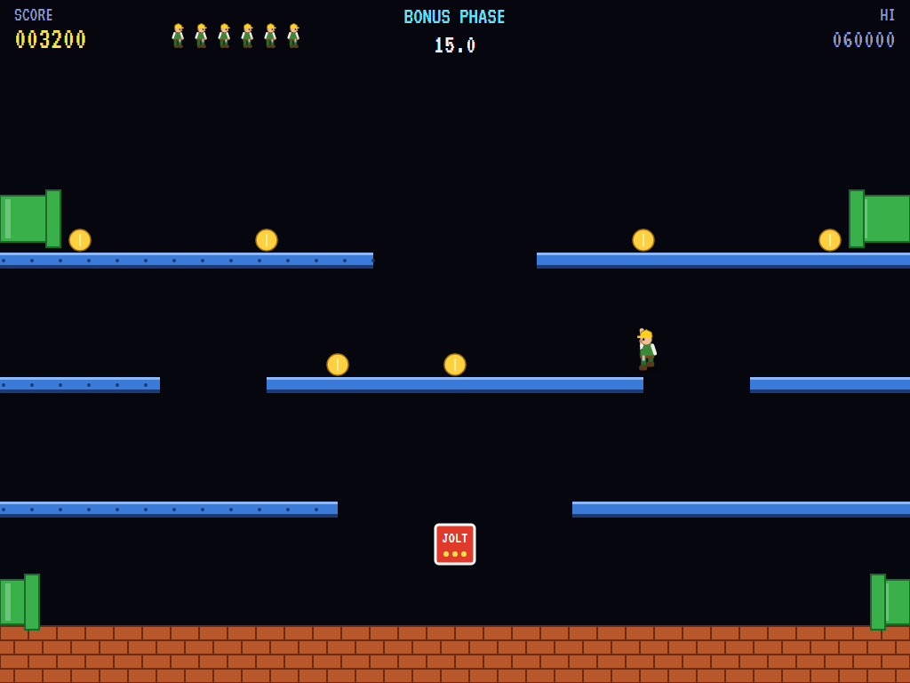
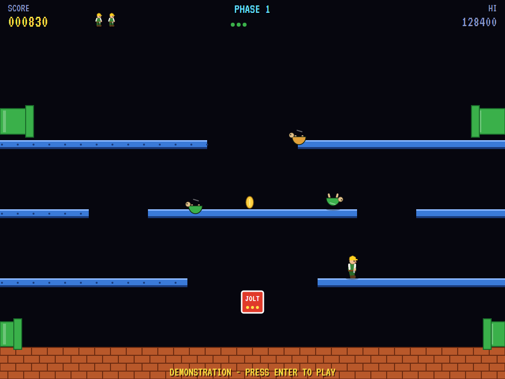

# AVA Mario Bros

[](https://github.com/Harlock123/AVAMarioBros/actions/workflows/build.yml)

A single-screen platform game in the style of Nintendo's 1983 arcade game **Mario Bros.**, built with .NET 10
and Avalonia UI. You don't stomp the pests in this one: they're knocked over from underneath. A mechanic in a
hard hat jumps up under the ledge a pest is walking on, and the bump flips it onto its back; then he goes up
and kicks it off before it gets up again, quicker and cross. The pests come out of the pipes at the top, walk
the ledges, drop off the ends, and go back in at the bottom.

The mechanic, the pests and everything else in it are this game's own; there are no Nintendo characters in it.

## Features

- **The mechanic** walks (and slides a little when he stops), and jumps high enough to reach the next ledge up
  through a gap. His head bumps the underside of a ledge he jumps under, and the ledge bulges up where it's hit.
- **The room** wraps round at the sides, so the side ledges join up across the edge. There are pipes at the
  top corners, where the pests come out, and at the bottom corners, where they go back in to come out again
  on the other side.
- **The pests:**
  - **Shellbacks** go over with one bump.
  - **Clawcrabs** take two: the first only makes them angry, and quicker.
  - **Hopflies** hop along, and can only be bumped while they're down on a ledge.
- **On its back,** a pest waves its legs for a few seconds, then gets up again, quicker and a new colour. Bump
  it again and it's turned back over. Kick it off for 800, and more for each in quick succession. Every kick
  sends a coin rolling out of a top pipe (800).
- **The jolt block** knocks over every pest on every ledge at once. It holds three jolts, and is filled up
  again on each bonus phase.
- **A fireball** comes drifting across the room on a wavy line if a phase goes on too long. Bump the ledge
  under it to put it out (1000).
- **The last pest** of a phase goes quicker, but never quite as quick as the mechanic.
- **Phases:** shellbacks, then clawcrabs, then hopflies, then all of them together, more each time round.
  Every third phase is a **bonus phase**: ten coins round the room and 20 seconds to gather them, with 5000
  for getting them all. There's an extra life every 20000.
- **The attract mode** plays itself. The computer player has worked out the room for itself, by trying
  every way of walking off and jumping up from every ledge with the mechanic's own movement. It:
  - gets under where a pest will be and jumps as it comes over
  - waits for a fly to land before bumping it
  - kicks the flipped ones and fetches the coins
  - keeps clear of the gaps pests are about to drop through, and uses the jolt block when the floor's crowded
- **The sounds** are all synthesised: the thunk of a bump, the boing of a pest going over, the kick, the coin,
  the jolt, and a bouncy little tune.

## Screenshots

| The title | A bump | A kick |
|:---------:|:------:|:------:|
|  |  |  |
| The pests, and what they're worth. | The ledge bulges up under a shellback. | Off it goes, and out comes a coin. |

| Clawcrabs | Hopflies | The fireball |
|:---------:|:--------:|:------------:|
|  |  |  |
| Two bumps each. | Only when they land. | Put it out from below. |

| The jolt block | A bonus phase | The high scores |
|:--------------:|:-------------:|:---------------:|
|  |  |  |
| Everything on the floor over at once. | Ten coins against the clock. | The master mechanics. |

The screenshots are made by the tests, which play the game in a real (headless) window; see
[Tests](#tests).

## Download and run

Ready-to-run builds for Windows, macOS and Linux, on both Intel/AMD and ARM, are on the
[Releases page](https://github.com/Harlock123/AVAMarioBros/releases/tag/latest). **Latest build** is
rebuilt on every push to `main`. Each download is one self-contained executable: no .NET install is
needed.

| Platform | Archive |
|---|---|
| Windows | `AVAMarioBros-win-x64.zip`, `AVAMarioBros-win-x86.zip`, `AVAMarioBros-win-arm64.zip` |
| macOS | `AVAMarioBros-osx-arm64.tar.gz` (Apple silicon), `AVAMarioBros-osx-x64.tar.gz` (Intel) |
| Linux | `AVAMarioBros-linux-x64.tar.gz`, `AVAMarioBros-linux-arm64.tar.gz`, `AVAMarioBros-linux-arm.tar.gz` |

```bash
tar -xzf AVAMarioBros-linux-x64.tar.gz     # or linux-arm64, linux-arm, osx-arm64, osx-x64
./AVAMarioBros
```

On Windows, unzip and run `AVAMarioBros.exe`. On macOS, if Gatekeeper refuses to open it, run
`xattr -d com.apple.quarantine AVAMarioBros` once. Run with `--no-audio` for silence.

**Sound** comes through OpenAL Soft, built in for every platform. In a virtual machine the game
detects it and uses a larger audio buffer, so the sound doesn't break up.

**Gamepads** use SDL2, which is bundled for Windows, macOS and Intel/AMD Linux. ARM Linux builds need it
installed; without it the keyboard still works:

```bash
sudo apt install libsdl2-dev            # Debian / Ubuntu / Raspberry Pi OS
sudo pacman -S --needed sdl2-compat     # Arch / Omarchy
```

## Controls

| Action | Keyboard | Gamepad |
|---|---|---|
| Start | Enter or 1 | Start |
| Walk | Left / Right (or A / D) | Left stick / D-pad |
| Jump | Space, Up, W, Z, X or Ctrl | A, B, X or up |
| Pause | P or Esc | Start |
| Quit (while paused) | Esc | Back |
| Sound on/off | M | |
| Screenshot | Ctrl+S (to your Pictures folder) | |

On the high-score table, type your initials, or use up/down and Space, then Enter.

## Tests

```bash
dotnet test AVAMarioBros.slnx
```

The engine has no UI and runs in fixed 60 Hz steps, so it plays the same at any frame rate, and a seed
always plays the same game. The tests check:

- **The room:** wrapping round, with the side ledges joining up
- **The mechanic:**
  - walking, sliding to a stop, and jumping up to the next ledge
  - bumping a ledge and knocking over the pest just above
- **The pests:**
  - getting up again quicker, and a second bump turning one back
  - the crab's two bumps
  - the fly only when it's down
  - kicks scoring more in a row, each sending out a coin
  - a pest on its feet being the end of him, and coming back from the top
  - dropping off ledges and going round through the pipes
  - the last one's speed
- **The rest:**
  - the jolt block's three jolts
  - coins
  - the fireball (put out, and deadly)
- **The machine:**
  - phases ending, the bonus phase and its perfect bonus
  - each round's new pests
  - extra lives, the last life, and initials
  - the title and demonstration, and starting a game
  - the computer player clearing the first phase
  - the same game from the same seed, and pausing

The screenshot tests draw the real screen in a headless window. To refresh the README's pictures:

```bash
MARIOBROS_SHOTS=$PWD/Images dotnet test tests/AVAMarioBros.Tests --filter ScreenshotTests
```

To see how the computer player gets on, phase by phase (for tuning; `1` for the pilot, `lazy` for one that
just runs back and forth jumping):

```bash
MARIOBROS_PROBE=1 dotnet test tests/AVAMarioBros.Tests --filter PilotProbe --logger "console;verbosity=detailed"
```

## Building

```bash
dotnet build AVAMarioBros.slnx
dotnet run --project src/AVAMarioBros
```

Needs the .NET 10 SDK. The sounds are made by `tools/make_sounds.py` (standard-library Python):
`python3 tools/make_sounds.py` rewrites `src/AVAMarioBros/Sounds`.

## Project structure

```
AVAMarioBros/
├── AVAMarioBros.slnx
├── src/AVAMarioBros/
│   ├── Engine/
│   │   ├── GameEngine.cs        # States, the title and demo cycle, the music
│   │   ├── GameEngine.Play.cs   # The mechanic, bumps and kicks; the pests and the pipes; coins, the jolt
│   │   │                        # block and the fireball; phases and scoring
│   │   ├── MechanicPilot.cs     # The computer player, for the demonstration (and the tests)
│   │   ├── Entities.cs          # The room and its ledges; the mechanic, the pests and everything else
│   │   ├── HighScoreTable.cs, InitialsEntry.cs
│   │   ├── InputHandler.cs, ControllerManager.cs  # Keys and an SDL2 gamepad
│   │   └── SoundManager.cs      # Effects and the tunes through OpenAL
│   ├── Audio/                   # The OpenAL engine (from the author's AVABand)
│   ├── Views/                   # The drawing: the room, the mechanic, the pests and the screens
│   └── Sounds/                  # The synthesised effects and tunes
├── tests/AVAMarioBros.Tests/    # Gameplay, screenshot and probe tests
├── tools/make_sounds.py
└── Images/                      # Screenshots
```

## About and licence

AVA Mario Bros © 2026 Lonnie Watson, under the [MIT License](LICENSE).

*Mario Bros.* © 1983 Nintendo; the names Mario and Mario Bros. are Nintendo's trademarks. AVA Mario Bros is an
independent, unofficial game in the style of the arcade original. Its mechanic, pests, room, graphics,
sounds, tunes and code are its own; nothing is taken from the arcade machine's program, graphics, sound or
music, and none of Nintendo's characters appear in it. It is not affiliated with or endorsed by Nintendo.
